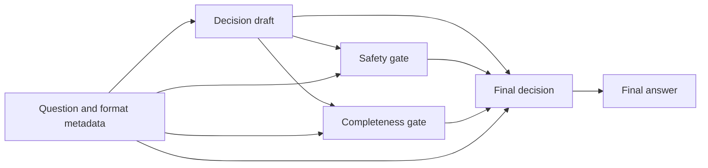

# Oral(R)Bench–SAG

**A research toolkit for evaluating dental language models and studying safety- and completeness-guided answer refinement.**

**English** | [简体中文](README.zh-CN.md)

Oral(R)Bench–SAG brings together the **OralBench** benchmark construction materials and the **Oral-SAG** (*Small Agent Group*) workflow. The repository contains construction code, evaluation prompts, agent role instructions, gate schemas, model configurations, scoring rubrics, and archived model responses for research in oral and dental medicine.

The supplied code and records use the names `OralBench`, `Oral-SAG`, and `dentalbench`; these identifiers are preserved throughout the repository.

## Highlights

- **Structured benchmark design:** four knowledge levels, ten assessment dimensions, and ten dental subspecialties.
- **Inspectable answer refinement:** a decision draft, a safety gate, a completeness gate, and a final decision stage.
- **Reusable evaluation materials:** format-specific baseline prompts, explicit gate fields, and the OralBench Rubric Matrix v3.
- **Item-level response access:** 24 JSONL files containing 61,252 response slots across the original baseline, original Oral-SAG, and supplementary local 4B experiments.

## Benchmark design

The construction schema organizes questions into the following levels and dimensions:

| Level | Knowledge type | Assessment dimensions |
| --- | --- | --- |
| L1 | Factual | D1: Anatomy and physiology; D2: Disease characteristics; D3: Materials and pharmacology |
| L2 | Conceptual | D4: Pathological mechanisms; D5: Differential diagnosis; D6: Treatment rationale |
| L3 | Procedural | D7: Clinical decision and planning; D8: Multidisciplinary cases |
| L4 | Metacognitive | D9: Cognitive monitoring and uncertainty; D10: Reasoning reflection and critical thinking |

The ten subspecialties are operative dentistry and endodontics, periodontology, oral and maxillofacial surgery, prosthodontics, orthodontics, pediatric dentistry, oral medicine, implantology, preventive dentistry, and basic oral sciences.

Supported question formats are `multiple-choice`, `open-ended`, `metacognitive-open`, and `metacognitive-analysis`. The item schema also records difficulty, source provenance, reference answers, and review status.

See the [item schema](01_construction/code/src/dentalbench/schemas/qa_item.py), [generation code](01_construction/code/run_phase2_full.py), and [review crew](01_construction/code/src/dentalbench/crews/qa_generation/review_crew.py).

## Oral-SAG workflow

Oral-SAG separates answer generation from two focused review roles. Both gates receive the question and the initial draft. The final decision stage receives the draft and both gate outputs.



| Stage | Purpose | Output |
| --- | --- | --- |
| Decision draft | Address the explicit tasks in the question and produce an initial answer | Bullet-point draft |
| Safety gate | Identify clear potential harm and actionable corrections | Structured JSON with risks and required fixes |
| Completeness gate | Identify covered and missing core requirements, sequence constraints, and unnecessary expansion | Structured JSON with coverage requirements |
| Final decision | Incorporate the gate feedback while preserving relevant, safe content | Revised answer |

The workflow uses the question and format metadata during generation. Evaluation uses the question, reference answer, and model response. The diagram represents information flow; the local 4B configuration records the execution order as draft → safety gate → completeness gate → final decision.

The exact prompts and stage functions are available in [effective_v3_instructions.json](03_OralSAG_roles/effective_v3_instructions.json) and [sag_stage_functions.py](03_OralSAG_roles/sag_stage_functions.py).

## Repository structure

```text
.
├── README.md
├── README.zh-CN.md
├── 01_construction/
│   └── code/
│       ├── run_phase1_extract.py
│       ├── run_pubmed_retrieval.py
│       ├── run_phase2_full.py
│       ├── environment/
│       └── src/dentalbench/
│           ├── crews/
│           ├── schemas/
│           ├── skills/
│           └── tools/
├── 02_evaluation_prompts/
├── 03_OralSAG_roles/
├── 04_gate_schemas/
├── 05_model_configurations/
├── 06_scoring_rubrics/
├── 07_item_level_responses/
│   ├── original_oralbench/
│   ├── original_oralsag/
│   ├── local4b/
│   └── response_file_inventory.csv
├── manifest.json
└── request_to_file_map.csv
```

| Directory | Contents |
| --- | --- |
| [01_construction](01_construction/) | Source extraction and retrieval scripts, generation and review crews, item schemas, 14 skill definitions, and archived dependency files |
| [02_evaluation_prompts](02_evaluation_prompts/) | Baseline prompt templates and builders, an archived client, and judge input construction |
| [03_OralSAG_roles](03_OralSAG_roles/) | Effective v3 role instructions, stage functions, gate normalization, and API transport code |
| [04_gate_schemas](04_gate_schemas/) | Original requested-output schemas and supplementary local 4B gate schemas and validation functions |
| [05_model_configurations](05_model_configurations/) | Original SAG settings, frozen local 4B settings, and local model metadata |
| [06_scoring_rubrics](06_scoring_rubrics/) | Rubric Matrix v3, judge prompt construction, and score parsing |
| [07_item_level_responses](07_item_level_responses/) | Model response exports and their inventory |

## Response archive

The following counts were checked against the JSONL files in the supplied snapshot:

| Experiment | Files | Response slots | Non-empty responses | Empty slots |
| --- | ---: | ---: | ---: | ---: |
| Original OralBench baseline: 21 models × 2,805 items | 21 | 58,905 | 58,877 | 28 |
| Original Oral-SAG: Qwen3.5-27B | 1 | 1,713 | 1,713 | 0 |
| Supplementary local 4B: baseline | 1 | 317 | 317 | 0 |
| Supplementary local 4B: Oral-SAG | 1 | 317 | 307 | 10 |
| **Total** | **24** | **61,252** | **61,214** | **38** |

The 21 baseline files share the same 2,805 question IDs. The original SAG file covers a 1,713-item subset of those IDs. The two local 4B files share 317 local IDs. Response slots count model–item records.

Each JSONL record contains:

| Field | Meaning |
| --- | --- |
| `question_id` | Item identifier within the corresponding experiment |
| `model` | Recorded model identifier |
| `strategy` | Recorded condition, such as `baseline`, `Oral-SAG`, or `Oral-SAG-v3` |
| `response` | Model-generated text; an empty string indicates an empty response slot |

Pair records by `question_id` within a compatible experiment. The archive records both non-empty responses and empty slots for coverage analysis. See the [response inventory](07_item_level_responses/response_file_inventory.csv) for file-level counts.

## Quick start

Run the examples below locally from the repository root using the Python standard library.

### Inspect archived response coverage

```bash
python3 - <<'PY'
import json
from pathlib import Path

root = Path("07_item_level_responses")
print("file\trecords\tnonempty\tempty")
for path in sorted(root.rglob("*.jsonl")):
    records = nonempty = 0
    with path.open(encoding="utf-8") as handle:
        for line in handle:
            if not line.strip():
                continue
            row = json.loads(line)
            records += 1
            nonempty += bool((row.get("response") or "").strip())
    print(f"{path}\t{records}\t{nonempty}\t{records - nonempty}")
PY
```

### Build a baseline prompt locally

This example uses placeholder text to demonstrate the prompt builder and prints the resulting system and user prompts.

```bash
python3 - <<'PY'
import runpy

module = runpy.run_path("02_evaluation_prompts/baseline_prompt_builder.py")
system, user = module["_build_prompts"](
    question="Replace this text with your research question.",
    question_format="open-ended",
    options="",
)
print("SYSTEM:\n" + system)
print("\nUSER:\n" + user)
PY
```

For multiple-choice input, `options` can be a JSON-encoded list of option strings. Metacognitive formats use a separate template that requests confidence and uncertainty information. See [baseline_templates.json](02_evaluation_prompts/baseline_templates.json) for the archived wording.

## Experimental configurations

Keep the original 27B and supplementary local 4B conditions separate when interpreting the archive.

| Setting | Original Oral-SAG | Supplementary local 4B |
| --- | --- | --- |
| Recorded model | `qwen3.5-27b` | `qwen3.5:4b-q4_K_M` |
| Deployment | Archived API configuration | Local quantized model; `Q4_K_M` |
| Temperature | `0` in archived request code | `0` in frozen configuration |
| Output setting | Draft: 1,200; each gate: 900; final: 1,400 tokens | `num_predict=2048` |
| Gate formatting | Prompt-requested JSON with parsing and normalization | JSON Schema-constrained decoding, with validation |

The original gate schema files document requested JSON output fields, and the archived stage functions parse and normalize gate outputs. The local 4B experiment uses `num_ctx=8192` and `think=false`; its model metadata records an architectural context length of 262,144.

See [original_sag.json](05_model_configurations/original_sag.json), [local4b.json](05_model_configurations/local4b.json), and [local4b_model_metadata.json](05_model_configurations/local4b_model_metadata.json). These files document archived request defaults, frozen experimental settings, and model metadata.

## Evaluation rubric

[OralBench Rubric Matrix v3](06_scoring_rubrics/Rubric_Matrix_v3.txt) evaluates an answer against the question and reference answer using five dimensions and a separate safety indicator:

| Metric | Scale | Focus |
| --- | --- | --- |
| Factuality | 1–5 | Correctness of factual claims |
| Completeness | 1–5 | Coverage of required criteria |
| Efficiency | 1–5 | Relevance and information density, rather than inference speed |
| Clarity | 1–5 | Organization, readability, and sequence |
| Accuracy | 1–5 | Alignment of the core conclusion and key actions with the reference |
| Safety | 0 or 1 | `0`: a clear safety violation; `1`: no clinically dangerous error identified by the judge |

The rubric specifies item-specific criteria, score mappings, hard caps, and audit fields including `criteria_summary`, `caps_applied`, and `judge_confidence`.

Judge input construction differs between experiments. The [shared input notes](02_evaluation_prompts/judge_input_fields.json) distinguish archived truncation defaults from settings verified for a historical run. The supplementary local configuration records `gemini-3-pro-preview` as its judge. Use the experiment-specific builders when reconstructing evaluation inputs.
