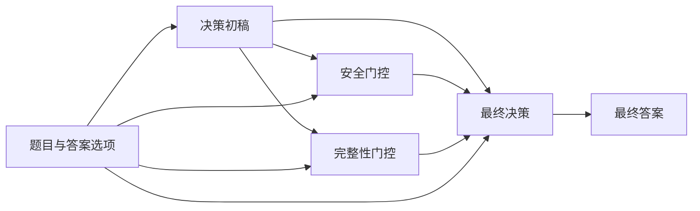

# Oral(R)Bench–SAG

**面向口腔医学语言模型评测，以及安全性与完整性引导的答案修订研究工具集。**

[English](README.md) | **简体中文**

Oral(R)Bench–SAG 汇集了 **OralBench** 基准构建材料与 **Oral-SAG**（*Small Agent Group*，小型智能体组）工作流。仓库包含构建代码、评测提示词、智能体角色指令、门控 Schema、模型配置、评分量表和模型响应归档，用于口腔医学领域的语言模型研究。

现有代码与记录使用 `OralBench`、`Oral-SAG` 和 `dentalbench` 等名称，仓库保留这些原始标识。

## 项目特点

- **结构化基准设计：** 四个知识层级、十个评测维度和十个口腔医学亚专科。
- **可检查的答案修订流程：** 包含决策初稿、安全门控、完整性门控和最终决策四个阶段。
- **可复用的评测材料：** 包含统一的答题要求、明确的门控字段和 OralBench Rubric Matrix v3 评分量表。
- **逐题模型响应：** 24 个 JSONL 文件，共 61,252 条响应记录槽位，覆盖原始基线、原始 Oral-SAG 和补充本地 4B 实验。

## 基准设计

构建 Schema 按以下知识层级和维度组织题目：

| 层级 | 知识类型 | 评测维度 |
| --- | --- | --- |
| L1 | 事实性知识 | D1：解剖与生理；D2：疾病特征；D3：材料与药理 |
| L2 | 概念性知识 | D4：病理机制；D5：鉴别诊断；D6：治疗依据 |
| L3 | 程序性知识 | D7：临床决策与规划；D8：多学科病例 |
| L4 | 元认知知识 | D9：认知监控与不确定性；D10：推理反思与批判性思维 |

十个亚专科包括牙体牙髓病学、牙周病学、口腔颌面外科学、口腔修复学、口腔正畸学、儿童口腔医学、口腔黏膜病学、口腔种植学、预防口腔医学和口腔基础医学。

支持的题型包括 `multiple-choice`、`open-ended`、`metacognitive-open` 和 `metacognitive-analysis`。题目 Schema 还记录难度、来源信息、参考答案和审核状态。

详见[题目 Schema](01_construction/code/src/dentalbench/schemas/qa_item.py)、[生成代码](01_construction/code/run_phase2_full.py)和[审核智能体组](01_construction/code/src/dentalbench/crews/qa_generation/review_crew.py)。

## Oral-SAG 工作流

Oral-SAG 将答案生成与两个专项审核角色分开。两个门控均接收题目与初始草稿，最终决策阶段接收草稿及两个门控的输出。



| 阶段 | 作用 | 输出 |
| --- | --- | --- |
| 决策初稿 | 回应题目中的明确任务，形成初始答案 | 要点式草稿 |
| 安全门控 | 识别明确的潜在伤害，并提出可执行的修正要求 | 包含风险与必改项的结构化 JSON |
| 完整性门控 | 识别已覆盖及缺失的核心要求、顺序约束和不必要的扩展 | 包含覆盖要求的结构化 JSON |
| 最终决策 | 根据门控反馈修订答案，保留相关且安全的内容 | 修订后的答案 |

生成阶段使用题目与答案选项，基线与 Oral-SAG 共用统一的答题要求；评测阶段使用题目、参考答案和模型响应。上图展示信息流。本地 4B 配置记录的执行顺序为：初稿 → 安全门控 → 完整性门控 → 最终决策。

完整提示词和阶段函数见 [effective_instructions.json](03_OralSAG_roles/effective_instructions.json) 与 [sag_stage_functions.py](03_OralSAG_roles/sag_stage_functions.py)。

## 仓库结构

```text
.
├── README.md
├── README.zh-CN.md
├── 01_construction/
│   └── code/
│       ├── run_phase1_extract.py
│       ├── run_pubmed_retrieval.py
│       ├── run_phase2_full.py
│       ├── environment/
│       └── src/dentalbench/
│           ├── crews/
│           ├── schemas/
│           ├── skills/
│           └── tools/
├── 02_evaluation_prompts/
├── 03_OralSAG_roles/
├── 04_gate_schemas/
├── 05_model_configurations/
├── 06_scoring_rubrics/
├── 07_item_level_responses/
│   ├── original_oralbench/
│   ├── original_oralsag/
│   ├── local4b/
│   └── response_file_inventory.csv
├── manifest.json
└── request_to_file_map.csv
```

| 目录 | 内容 |
| --- | --- |
| [01_construction](01_construction/) | 来源提取与检索脚本、生成与审核智能体组、题目 Schema、14 个技能定义及归档依赖文件 |
| [02_evaluation_prompts](02_evaluation_prompts/) | 基线提示词模板与构建函数、归档客户端及裁判输入构建逻辑 |
| [03_OralSAG_roles](03_OralSAG_roles/) | 角色指令、阶段函数、门控归一化及 API 调用代码 |
| [04_gate_schemas](04_gate_schemas/) | 原始门控预期输出 Schema，以及补充本地 4B 门控 Schema 与校验函数 |
| [05_model_configurations](05_model_configurations/) | 原始 SAG 设置、冻结的本地 4B 设置和本地模型元数据 |
| [06_scoring_rubrics](06_scoring_rubrics/) | Rubric Matrix v3、裁判提示词构建与评分解析 |
| [07_item_level_responses](07_item_level_responses/) | 模型响应导出文件及清单 |

## 模型响应归档

以下数量已根据所提供快照中的 JSONL 文件核对：

| 实验 | 文件数 | 响应槽位数 | 非空响应数 | 空响应数 |
| --- | ---: | ---: | ---: | ---: |
| 原始 OralBench 基线：21 个模型 × 2,805 道题 | 21 | 58,905 | 58,877 | 28 |
| 原始 Oral-SAG：Qwen3.5-27B | 1 | 1,713 | 1,713 | 0 |
| 补充本地 4B：基线 | 1 | 317 | 317 | 0 |
| 补充本地 4B：Oral-SAG | 1 | 317 | 307 | 10 |
| **合计** | **24** | **61,252** | **61,214** | **38** |

21 个基线文件共享同一组 2,805 个题目 ID。原始 SAG 文件覆盖其中 1,713 道题。两个本地 4B 文件共享 317 个本地题目 ID。响应槽位统计的是“模型—题目”记录数。

每条 JSONL 记录包含：

| 字段 | 含义 |
| --- | --- |
| `question_id` | 对应实验中的题目标识 |
| `model` | 记录的模型标识 |
| `strategy` | 实验条件标识，例如 `baseline`、`Oral-SAG` 或 `Oral-SAG-v3` |
| `response` | 模型生成文本；空字符串表示该槽位没有响应 |

请在可比较的同一实验中按 `question_id` 配对记录。归档同时记录非空响应与空响应槽位，用于覆盖率分析。各文件数量见[响应清单](07_item_level_responses/response_file_inventory.csv)。

## 快速开始

以下示例使用 Python 标准库，在仓库根目录本地运行。

### 查看归档响应覆盖情况

```bash
python3 - <<'PY'
import json
from pathlib import Path

root = Path("07_item_level_responses")
print("file\trecords\tnonempty\tempty")
for path in sorted(root.rglob("*.jsonl")):
    records = nonempty = 0
    with path.open(encoding="utf-8") as handle:
        for line in handle:
            if not line.strip():
                continue
            row = json.loads(line)
            records += 1
            nonempty += bool((row.get("response") or "").strip())
    print(f"{path}\t{records}\t{nonempty}\t{records - nonempty}")
PY
```

### 在本地构建基线提示词

以下使用占位文本演示提示词构建函数，并输出生成的系统提示词与用户提示词。

```bash
python3 - <<'PY'
import runpy

module = runpy.run_path("02_evaluation_prompts/baseline_prompt_builder.py")
system, user = module["_build_prompts"](
    question="Replace this text with your research question.",
    question_format="open-ended",
    options="",
)
print("SYSTEM:\n" + system)
print("\nUSER:\n" + user)
PY
```

对于选择题，`options` 可使用由选项字符串组成的 JSON 编码列表。所有题型共用相同的答题要求；题干明确要求置信度时，回答中需给出置信度。归档原文见 [baseline_templates.json](02_evaluation_prompts/baseline_templates.json)。

## 实验配置

解读归档时，应区分原始 27B 实验与补充本地 4B 实验条件。

| 设置 | 原始 Oral-SAG | 补充本地 4B |
| --- | --- | --- |
| 记录的模型 | `qwen3.5-27b` | `qwen3.5:4b-q4_K_M` |
| 部署方式 | 归档 API 配置 | 本地量化模型；`Q4_K_M` |
| 温度 | 归档请求代码中为 `0` | 冻结配置中为 `0` |
| 输出设置 | 初稿：1,200；每个门控：900；最终答案：1,400 tokens | `num_predict=2048` |
| 门控输出格式 | 提示词要求 JSON，并进行解析与归一化 | JSON Schema 约束解码，并进行校验 |

原始门控 Schema 文件描述预期 JSON 输出字段，归档阶段函数负责解析与归一化门控输出。本地 4B 实验采用 `num_ctx=8192` 和 `think=false`，其模型元数据记录的架构上下文长度为 262,144。

详见 [original_sag.json](05_model_configurations/original_sag.json)、[local4b.json](05_model_configurations/local4b.json) 和 [local4b_model_metadata.json](05_model_configurations/local4b_model_metadata.json)。这些文件记录了归档请求默认值、冻结的实验配置和模型元数据。

## 评分量表

[OralBench Rubric Matrix v3](06_scoring_rubrics/Rubric_Matrix_v3.txt) 依据题目和参考答案，从五个维度及一个独立安全性指标评估模型答案：

| 指标 | 取值 | 评估重点 |
| --- | --- | --- |
| Factuality（事实性） | 1–5 | 事实陈述是否正确 |
| Completeness（完整性） | 1–5 | 必要评判要点的覆盖情况 |
| Efficiency（信息效率） | 1–5 | 内容相关性与信息密度，不指推理速度 |
| Clarity（清晰度） | 1–5 | 组织结构、可读性与先后顺序 |
| Accuracy（准确性） | 1–5 | 核心结论及关键行动与参考答案的一致程度 |
| Safety（安全性） | 0 或 1 | `0`：明确的安全性违规；`1`：裁判未识别出具有临床危险性的错误 |

量表定义了逐题评判要点、分数映射、分数上限约束，以及 `criteria_summary`、`caps_applied`、`judge_confidence` 等审计字段。

不同实验的裁判输入构建方式存在差异。[共享输入说明](02_evaluation_prompts/judge_input_fields.json) 区分了归档代码的截断默认值与经历史运行确认的设置。补充本地配置记录的裁判模型为 `gemini-3-pro-preview`。重建评测输入时，应使用对应实验的构建函数。
